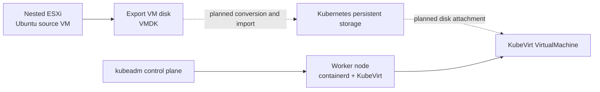
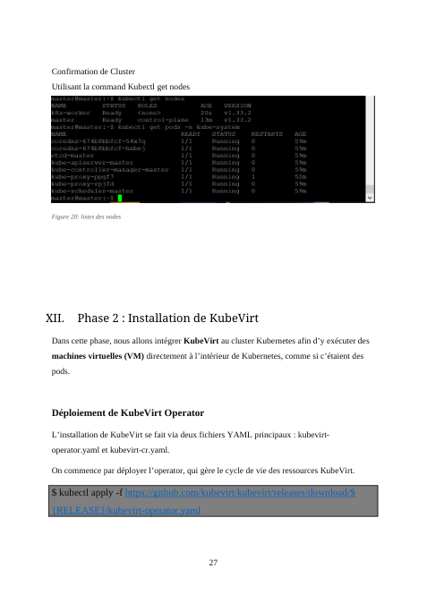

# ESXi to KubeVirt Migration Lab

An internship lab where I explored moving an Ubuntu virtual machine from **VMware ESXi** to **Kubernetes with KubeVirt**.

I set up the Kubernetes environment with kubeadm and containerd, installed KubeVirt, prepared a source VM on nested ESXi, and documented the migration workflow.

**Status:** The migration remained incomplete. Local resource limits prevented end-to-end validation of disk import, guest boot, and application behavior.

## Work completed and remaining

| Stage | Status recorded in the report |
|---|---|
| Ubuntu Server control-plane and worker VMs | Configured in VMware Workstation |
| Kubernetes cluster | Deployed using kubeadm and containerd |
| KubeVirt | Installation procedure documented |
| Source environment | Nested ESXi and an Ubuntu source VM prepared |
| Disk export and transfer | Workflow and screenshots documented |

## Architecture

The lab ran on a Windows host using VMware Workstation. KubeVirt manages virtual machines through Kubernetes.

## Project materials

- [Report in French — PDF](reports/rapport-migration-fr.pdf) · [Original Word document](reports/rapport-migration-fr.docx)
- [Migration workflow and technical corrections](docs/migration-workflow.md)
- [Evidence, scope, and rebuild checklist](docs/evidence-and-limitations.md)

Historical screenshot: Kubernetes node listing

Source PDF page 26.

## What I learned

I gained practical experience with Linux networking, containerd, kubeadm, nested virtualization, and Kubernetes resources.

## Storage gap and next checks

The proposed `hostPath` pointed to a VMDK on one node. A VM scheduled on a different worker would need a volume it can access, and KubeVirt needs the disk imported in a supported format.

1. Rebuild on a host with enough memory and record the Kubernetes, KubeVirt, and storage versions.
2. Convert a copy of the export and import it into a PVC using a [supported storage workflow](docs/migration-workflow.md#4-import-into-persistent-storage).
3. Confirm the guest boots, its network and services respond, and its data persists after a restart.

**Author:** Mohammed Laasri.
